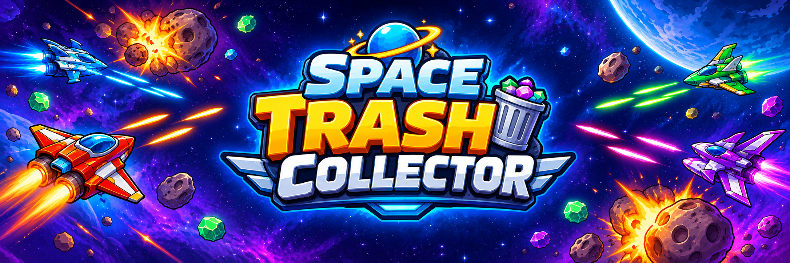

🚀 Space Trash Collector – Phi Thuyền Thu Rác Vũ Trụ
   

     
   

Game bắn máy bay 2D (Space Shooter) làm bằng Unity, ngôn ngữ C#. Người chơi lái phi thuyền phá thiên thạch, thu gom rác vũ trụ rơi ra để nạp năng lượng và tung đòn tấn công đặc biệt.

Đồ án môn Đồ án tương tác đối tượng trong môi trường ảo
🎮 Cách chơi
Phím	Chức năng
W A S D hoặc ↑ ← ↓ →	Di chuyển phi thuyền
Space (giữ)	Bắn đạn
Left Shift	Đòn đặc biệt: bắn chùm 5 viên (khi thanh năng lượng đạt 100%)
Esc hoặc P	Mở / đóng bảng Cài đặt khi đang chơi
R	Chơi lại (ở màn Game Over)
M	Về menu (ở màn Game Over)

Luật chơi

Bắt đầu với 3 mạng. Thiên thạch đâm vào tàu thì mất 1 mạng.
Bắn nổ thiên thạch để lấy điểm. Thiên thạch nổ có thể văng ra rác vũ trụ.
Điều khiển tàu chạm vào rác để nạp năng lượng. Đầy 100% thì bấm Shift để bắn chùm đạn.
Cứ mỗi 500 điểm, tàu được tăng lực 5 giây: tự động bắn 3 tia liên tục, hết giờ quay về 1 tia.
Game khó dần theo thời gian: thiên thạch xuất hiện dày hơn và rơi nhanh hơn.
Hết 3 mạng: tàu nổ, game chậm lại, phát tiếng thua rồi mới hiện bảng điểm.
✨ Tính năng
Luồng bắt đầu: PLAY → nhập tên phi công → chọn bản đồ → chọn phi thuyền → vào game.
5 phi thuyền, mỗi tàu có đạn, tốc độ bắn và màu lửa động cơ riêng:
Phi thuyền	Đặc điểm
Băng Giá	Tia băng, dễ làm quen
Bóng Đêm	Xung hư không, nhịp bắn nhanh
Độc Dược	Nọc độc, bắn đều tay
Hoàng Kim	Tia hoàng gia, nhịp bắn vừa phải
Phượng Hoàng	Tia lửa, tốc độ bắn cao nhất
5 bản đồ cuộn vô tận: Tinh Vân Tím, Vành Đai Thiên Thạch, Hành Tinh Băng, Vùng Dung Nham, Bãi Rác Vũ Trụ.
6 loại thiên thạch, mỗi loại có máu, điểm, tốc độ, kích thước và màu nổ riêng; 6 loại rác chia đều ngẫu nhiên:
Thiên thạch	Máu	Điểm	Rác
Đá Thường	1	10	Mảnh Đá
Băng Giá	1	15	Tinh Thể Băng
Dung Nham	2	25	Than Dung Nham
Kim Loại	3	35	Phế Liệu Kim Loại
Phóng Xạ	2	30	Lõi Phóng Xạ
Pha Lê (hiếm, nhanh)	1	50	Đá Quý
Hiệu ứng làm bằng code (không cần ảnh): nổ (chớp sáng, sóng xung kích, mảnh vỡ, tia lửa), rác bị hút về phía tàu khi lại gần, lửa động cơ có hạt bay và đổi hướng theo chuyển động.
Bảng xếp hạng Top 10 theo tên người chơi (hiện Top 5 ở màn nhập tên) và điểm cao nhất được lưu trong máy.
Giao diện: HUD điểm, năng lượng, mạng; khung đếm ngược tăng lực; bảng Game Over có điểm chạy lên và huy hiệu kỷ lục; bảng Cài đặt (âm lượng, toàn màn hình).
Âm thanh: nhạc nền, tiếng bắn, nổ, nhặt rác, va chạm, tiếng thua.
🛠️ Cài đặt và chạy project

Yêu cầu: Unity 6000.6.7f1 (Unity 6.6) và Visual Studio (hoặc VS Code) để sửa code.

Tải hoặc clone repo về máy.
Mở Unity Hub → Add → chọn thư mục project → mở bằng đúng phiên bản Unity ở trên (lần đầu mở sẽ mất vài phút để Unity tạo lại thư mục Library).
Vào Edit → Project Settings → Player → Other Settings, đặt Active Input Handling = Both (project dùng Input Manager cũ).
Mở scene Assets/Scenes/MainMenu và bấm Play.

Build ra file .exe: File → Build Profiles → Windows → Build. Thứ tự scene trong Scene List: 0 = MainMenu, 1 = Game.

📁 Cấu trúc project
Assets/
├── Audio/        Nhạc nền và hiệu ứng âm thanh
├── Prefabs/      Asteroid, Bullet, Trash
├── Resources/    GameCatalog.asset  (kho dữ liệu của game)
├── Scenes/       MainMenu, Game
├── Scripts/      Mã nguồn C#
├── Sprites/      Hình ảnh: tàu, đạn, bản đồ, thiên thạch, rác, giao diện
└── TextMesh Pro/ Font Exo 2

Các script chính (Assets/Scripts)

Script	Nhiệm vụ
GameManager	Điểm, mạng, năng lượng, tăng lực 500 điểm, chuỗi kết thúc game, lưu kỷ lục
GameUI	Dựng toàn bộ giao diện trong game (HUD, Game Over, Cài đặt) bằng code
GameSetup	Áp dụng lựa chọn của người chơi: tàu, đạn, bản đồ, lửa động cơ, tên phi công
GameCatalog	ScriptableObject chứa dữ liệu tàu, bản đồ, thiên thạch, rác
PlayerController	Di chuyển, bắn 1 tia / 3 tia, đòn Shift
Asteroid, Trash, Spawner	Thiên thạch, rác, bộ sinh thiên thạch ngẫu nhiên
Bullet	Đạn bay và va chạm
ExplosionFX, EngineFlame	Hiệu ứng nổ và lửa động cơ
PowerUpHUD	Khung đếm ngược khi tăng lực
SetupFlow, PlayerProfile	Các màn nhập tên, chọn bản đồ, chọn tàu; lưu tên và bảng xếp hạng
MenuController, MenuSettings	Nút menu và bảng Cài đặt ở màn hình chính

Chỉnh dữ liệu game: mở Assets/Resources/GameCatalog.asset trong Unity. Tại đây đổi được ảnh, máu, điểm, tốc độ, kích thước, cách chia loại thiên thạch và rác mà không cần sửa code.

📦 Tài nguyên sử dụng
Font: Exo 2 – Google Fonts (giấy phép OFL)
Hình ảnh: logo, nút, bản đồ, phi thuyền, đạn, thiên thạch, rác được tạo bằng ChatGPT; một số hình mặc định từ gói Space Shooter Redux của Kenney (CC0)
Âm thanh: hiệu ứng từ gói của Kenney (CC0) và Pixabay
Nhạc nền: lấy nguồn trên web
📝 Ghi chú
Công tắc Toàn màn hình chỉ có tác dụng khi chơi bản build (.exe), không đổi gì trong Unity Editor.
Dữ liệu người chơi (tên, điểm cao, bảng xếp hạng, cài đặt âm lượng) lưu bằng PlayerPrefs trên máy.
Thư mục Library, Temp, Logs được bỏ qua bằng .gitignore; Unity sẽ tự tạo lại khi mở project.
